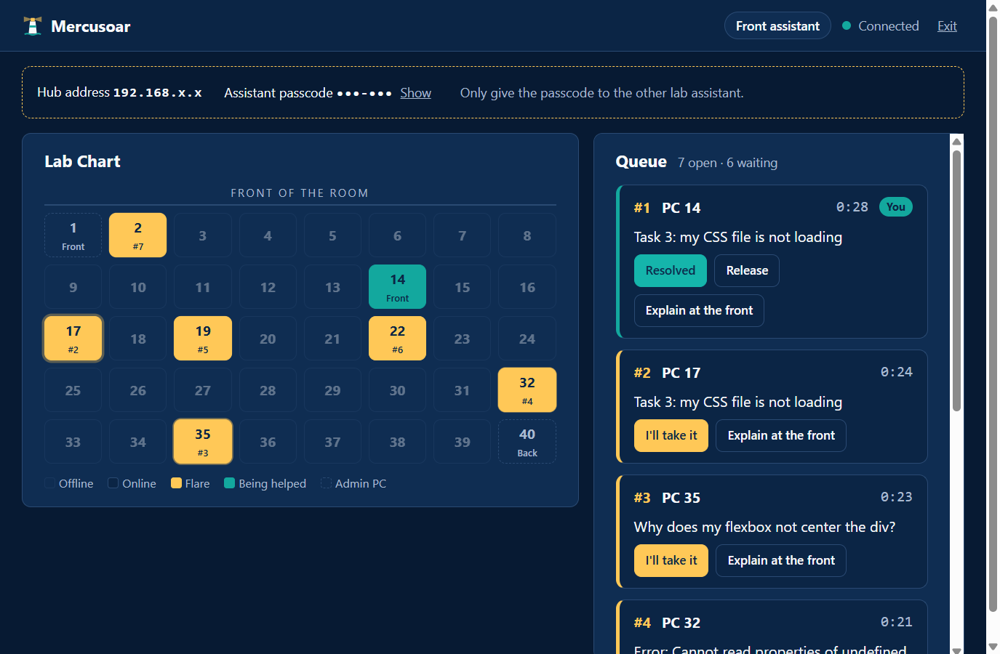
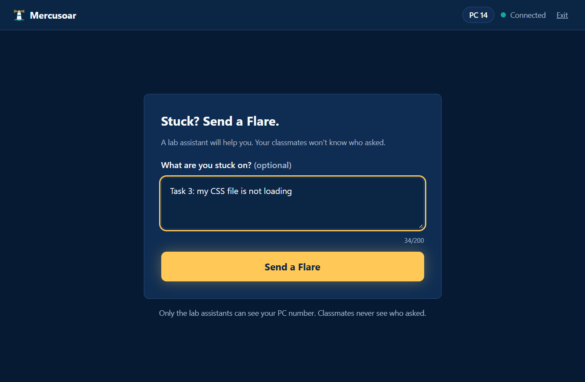
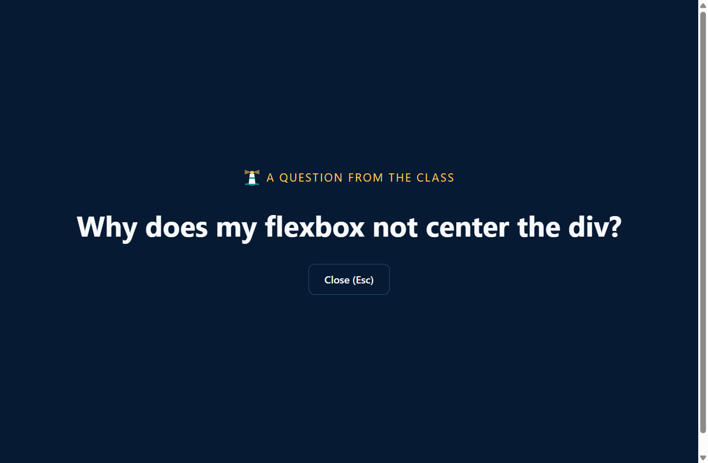
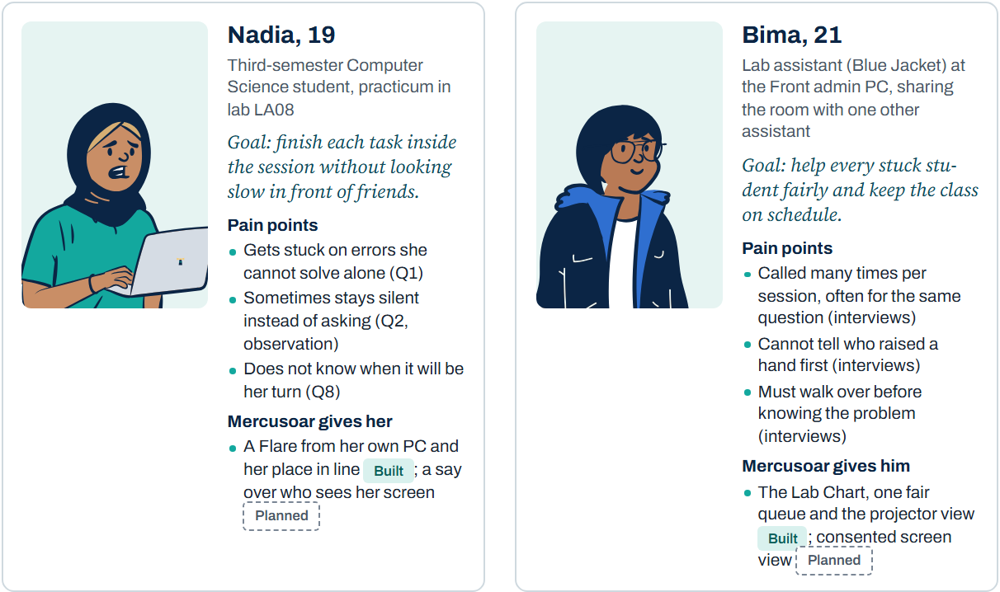
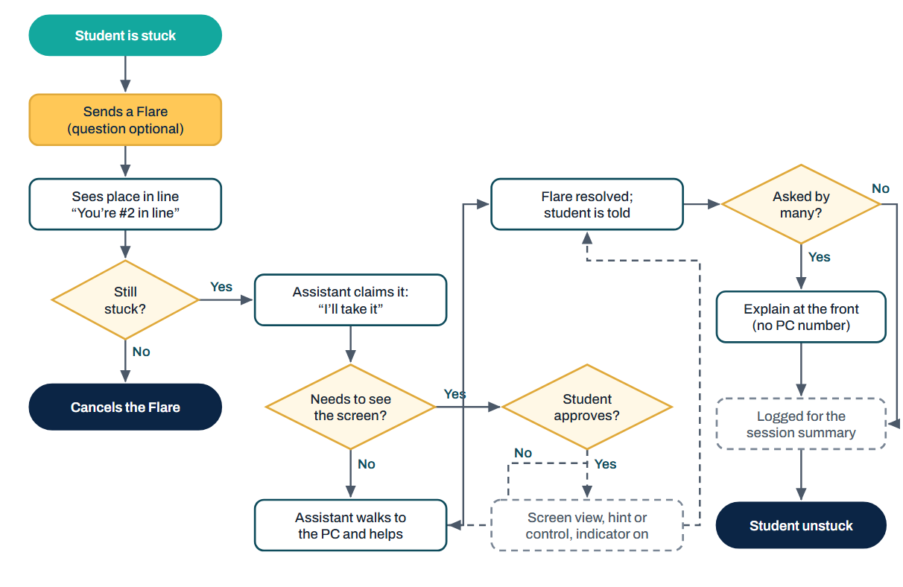
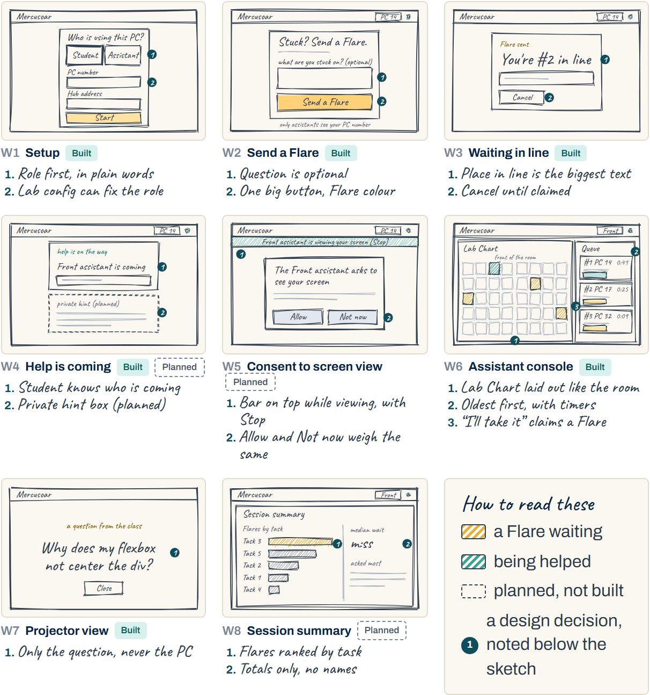

<p align="center">
  
</p>

<h1 align="center">Mercusoar</h1>

<p align="center">
  <b>Anonymous help requests for university computer labs.</b><br>
  A student sends a Flare; the lab assistants see which PC needs help. Classmates see nothing.
</p>

<p align="center">
  STACK 2026 by GDGoC ITB · Case 1: Smarter Campus and Learning · BINUS University
</p>

<p align="center">
  <a href="https://mercusoar-prototype.vercel.app"><b>Clickable prototype</b></a> ·
  <a href="https://www.figma.com/design/MVSDxDAubJHTvxX75jbAkN"><b>Figma design file</b></a> ·
  <a href="#design">Design</a> ·
  <a href="#getting-started">Run it yourself</a>
</p>

<p align="center">
  
</p>

---

## The problem

A BINUS computer lab has about 40 PCs and two lab assistants ("Blue Jackets"). One assistant sits at the admin PC at the front (PC 1), the other at the back (PC 40). First- to third-semester Computer Science students spend their practicum sessions here, working through numbered tasks.

When a student gets stuck, the only way to get help is to raise a hand or call an assistant over, in front of everyone. That causes three problems:

1. **Stuck students stay silent.** In our survey, 36% said they sometimes don't ask even when they are stuck. In the two classes we observed (LA08 and LB08, 60 students), about three in four stuck students stayed silent instead of raising a hand.
2. **Waiting is invisible.** A student who asks can't see their place in line, and help goes to whoever catches an assistant's eye. 49% of students want to know their place in line.
3. **Assistants repeat themselves.** Both assistants we interviewed are called many times per session, often for a question they just answered at another PC.

### Our evidence

| Source | What we did |
|---|---|
| Survey | 45 BINUS Computer Science students, 27 November 2026 |
| Observation | LA08 and LB08, third-semester classes of 30 students each, 27 September to 9 November 2026 |
| Interviews | Two BINUS lab assistants, 9 November 2026 |

The survey also corrected one of our assumptions: embarrassment holds some students back (22%) but not most, and long waits are uncommon (24%). Silence itself is common, so Mercusoar makes asking effortless for everyone and private for those who need it.

## The solution

Mercusoar is a Windows desktop app that runs on every lab PC. It turns the raised hand into a private request on the student's own PC, called a **Flare**.

| 1. Ask privately | 2. Get help in a fair order | 3. Learn together |
|---|---|---|
|  |  |  |
| PC 14 sends a Flare with an optional question. Classmates see nothing. | The Flare lights up on the Lab Chart, and one assistant claims it. | A repeated question goes on the projector, without its PC number. |

*Screenshots from the working app, with simulated students.*

| | Student PC | Lab assistant PC |
|---|---|---|
| **Sees** | Their own Flare, their place in line, who is coming | The Lab Chart, the queue and every Flare's question |
| **Does** | Sends a Flare (one click plus an optional short question), or cancels it | Claims a Flare, resolves it, releases it, or explains it at the front |
| **Never sees** | Other students or their Flares | — |

### Features in this prototype

- **Anonymous Flare.** One button plus an optional question of up to 200 characters. Nothing appears on any other student's screen.
- **Lab Chart.** A live map of the room's 40 seats. A seat pulses amber while its Flare is waiting and turns teal once an assistant has claimed it.
- **Fair queue.** Flares are first-come, first-served. Each one shows how long it has been waiting, and each student sees their own place in line.
- **Two assistants, no double work.** An assistant claims a Flare with "I'll take it", and the other assistant sees that it is taken.
- **Explain at the front.** Shows only the question text, full screen on the projector, never the PC number. The whole class learns from it and the student stays anonymous.
- **Assistant lock.** The assistant view needs a passcode that changes every session. A PC that guesses wrong too many times is locked out.
- **Lab config file.** Each lab PC can be fixed to its role and PC number, so students can't pick the assistant role.

### What makes it different

A help button on its own is not new. Classroom suites such as Veyon, NetSupport School and LanSchool are built for supervision: the teacher can open any screen without asking. Mercusoar is built around four rules instead, and the hub's code enforces them:

| Rule | Status | What it means |
|---|---|---|
| **Private by default** | ✅ Built | Students receive only their own Flare; only assistants see PC numbers. |
| **Fair by default** | ✅ Built | Oldest Flare first; only the assistant who claimed a Flare can resolve it. |
| **Consent before access** | 🔜 Planned | Screen view and control only after the student approves, with an indicator on screen. |
| **Local only** | ✅ Built | Every message stays on the lab network. |

### Roadmap

| Status | Feature |
|---|---|
| ✅ Built | Real-time hub, Flare, queue, Lab Chart, claim / release / resolve, projector view, passcode lock, lab config |
| 🔜 Next | **Beam**: after a Flare, the assistant can ask to view that student's screen and send a private hint. Nothing opens until the student approves, a bar stays on screen with a Stop button, and remote control needs a second approval. |
| 🔜 Next | **Logbook**: a history of help requests, stored in SQLite, with a session summary by task so assistants see which tasks students struggle with |
| 🔜 Next | Room layouts for every lab, reconnecting automatically after a restart, and finding the hub automatically |
| 🔜 Next | A Windows installer, and a pilot in a real BINUS lab |

**Plan to Final Day (16 December 2026):** a mini-lab trial with 6 to 10 volunteer classmates from 12 to 15 December. Each does one task set twice, once raising hands and once with Mercusoar, in swapped order. We will measure how many stuck students ask, waiting time and repeated explanations. On Final Day we will build remote control behind a second approval (FD1), the session summary from the Logbook (FD2), and fixes for the most serious problems found in the trial (FD3).

## Design

We designed Mercusoar before writing code. Everything below is also in the [Figma design file](https://www.figma.com/design/MVSDxDAubJHTvxX75jbAkN) and the [clickable prototype](https://mercusoar-prototype.vercel.app), where built screens and planned designs are labelled.

### User personas

Two composite personas, built only from our survey, interviews and observation. The names are invented; every pain point cites its source.



### User flow

From a student getting stuck to the help being shared with the class. Dashed steps are planned, not built yet.



### Low-fidelity wireframes

Hand-drawn sketches of every screen. W1, W2, W3, W6 and W7 are built; W5, W8 and the hint in W4 are planned. The numbered marks are the design decisions noted under each sketch.



### Visual design

The app keeps the night-sea look of the lighthouse logo. **Amber** is kept for Flares, so a waiting student stands out on the Lab Chart at a glance, and **teal** means someone is being helped. It uses Windows' built-in Segoe UI, so lab PCs need no extra fonts. Every text colour pair passes WCAG AA contrast; the lowest is 5.2:1.

## How it works

```
 Student PC 7 ─┐
 Student PC 12 ─┼──  WebSocket (LAN, port 47800)  ──►  Hub (runs inside the Front assistant's app, PC 1)
 Student PC … ─┘                                         │
                                                         ├──►  Front assistant (PC 1)
                                                         └──►  Back assistant  (PC 40, needs the passcode)
```

- The **hub** is a small WebSocket server written in Rust. It runs inside the Front assistant's app, so nothing else needs to be installed.
- The hub sends each student **only their own Flare**. Only assistants receive the queue and the PC numbers.
- The hub only uses the lab's local network. Nothing goes to the internet.

**Tech stack:** [Tauri 2](https://tauri.app) (Rust) · React 19 + TypeScript · Vite · tokio + tokio-tungstenite (WebSocket)

---

## Getting started

### Requirements

The app runs on **Windows 10/11**. Install these once:

1. **Rust**: <https://rustup.rs>
2. **Node.js 20 or newer**: <https://nodejs.org>
3. **Microsoft C++ Build Tools**: in the installer, tick **"Desktop development with C++"**. See the [Tauri prerequisites](https://tauri.app/start/prerequisites/).

WebView2 is already included in Windows 10/11.

### Run it

```powershell
git clone https://github.com/Jonathanjeheskiel/Mercusoar.git
cd Mercusoar\app
npm install
npm start
```

The first `npm start` compiles Rust and takes a few minutes. After that it takes seconds. **Keep this terminal open** while you use the app.

### Useful commands

Run these from the `app` folder.

| Command | What it does |
|---|---|
| `npm start` | Runs the app in development mode and opens the first window |
| `npm run window` | Opens **another** window. This only works while `npm start` is running. |
| `npm run demo` | Adds 5 **simulated** students that send Flares. Use `npm run demo -- 8` for 8 students. Run it **on the laptop that hosts the hub**: any other computer may only be one student PC. |
| `npm test` | Runs the Rust tests for the hub and the config |
| `npm run build:exe` | Builds a standalone `src-tauri\target\release\mercusoar.exe` that you can copy to another laptop |

---

## Using Mercusoar

### On one laptop (to try it out)

1. Run **`npm start`**. In the window, choose **Lab assistant**, then **Front (PC 1)**, keep **"Host the hub on this PC"** ticked, and click **Start**.
   If Windows Firewall asks, click **Allow** (Private networks).
2. In a second terminal, run **`npm run window`**. Choose **Student**, enter a PC number (for example **7**), leave the hub address as `127.0.0.1`, and click **Start**.
3. In the student window, type a question and click **Send a Flare**. PC 7 lights up on the assistant's Lab Chart.
4. In the assistant window, click **I'll take it**, then **Resolved**. The student sees each step.
5. Optional: run **`npm run demo`** in a third terminal to fill the lab with simulated Flares.

### On two laptops (same Wi-Fi or phone hotspot)

1. Connect both laptops to the **same network**. A phone hotspot works well. Campus Wi-Fi often blocks laptops from talking to each other.
2. On **laptop 1**, set the network to **Private** (Settings → Network & internet → Wi-Fi → your network → Network profile type → Private). Then start Mercusoar as the **Front** assistant hosting the hub. Note the **Hub address** shown at the top, for example `192.168.43.120`.
3. On **laptop 2**, start Mercusoar (`npm start`, or the `.exe` from `npm run build:exe`) and choose:
   - **Student**: enter laptop 1's hub address.
   - **or Lab assistant → Back**: enter the hub address and the **passcode**. On laptop 1, click **Show** next to the passcode to see it.
4. Want a busier lab? Run `npm run demo` on **laptop 1**. The hub only lets each computer be **one** student PC, so that classmates can't pose as each other. The hub's own laptop is the exception.
5. Can't connect? On laptop 2, run `Test-NetConnection <hub address> -Port 47800`. If the result is `False`, laptop 1's firewall or the hotspot is blocking the connection.

### Installing on real lab PCs (lab config)

Without a config file, Mercusoar runs in **developer mode** and shows the role picker, as in the steps above. On real lab PCs, create `C:\ProgramData\Mercusoar\config.json` to fix each PC's role:

```jsonc
// Student PC (2 to 39)
{ "role": "student", "pc": 7, "hub_address": "192.168.1.10" }

// Front assistant, PC 1 (hosts the hub)
{ "role": "assistant", "seat": "Front" }

// Back assistant, PC 40
{ "role": "assistant", "seat": "Back", "hub_address": "192.168.1.10" }
```

If the file exists but is invalid, Mercusoar shows an error and does **not** fall back to the role picker, so students can't use a broken file to reach the assistant role.

### Troubleshooting

| Problem | Fix |
|---|---|
| `could not open port 47800` | Another window is already hosting the hub. Close all Mercusoar windows and start again. |
| Student shows "Hub unreachable, retrying…" | The Front assistant hasn't clicked Start yet, the hub address is wrong, or the firewall is blocking the connection. |
| "Wrong passcode" | Click **Show** on the Front assistant's screen and type the passcode again. After 5 wrong tries that PC is locked out for 10 minutes. |
| `npm run window`: "localhost refused to connect" | `npm start` isn't running. Start it first. |

---

## Project structure

```
app/
├── src/                     React + TypeScript interface
│   ├── screens/             Setup, Student and Assistant screens
│   ├── components/          Lab Chart, projector view, connection badge, logo
│   ├── protocol.ts          Messages exchanged with the hub
│   └── useHub.ts            WebSocket connection, reconnects automatically
├── src-tauri/               Rust backend
│   └── src/
│       ├── hub.rs           The hub: queue, roles, passcode, limits (with tests)
│       └── lib.rs           Tauri commands and the lab config loader
└── scripts/demo-students.mjs   Simulated students for demos (test data only)
```

## Privacy and honesty notes

- **Anonymous to classmates:** no student ever receives another student's PC number or question.
- **Minimal data:** a Flare holds only a PC number, an optional question, when it was sent and who claimed it. There are no names, accounts or student IDs, and the queue ends with the session.
- **Tested:** all 22 automated tests pass (`npm test`), and the full flow from Flare to claim, resolve and projector has run on a team laptop with simulated students.
- **Simulated data:** `npm run demo` creates fake students. Any demo that uses it is labeled as simulated.
- **Prototype:** Mercusoar has not been tested with real students in a lab yet. Beam and the Logbook are planned but not built.

## AI assistance

In line with the STACK 2026 rules, we disclose that we used AI tools (Claude by Anthropic) to help write code. The team chose the idea and made the design decisions, and reviewed and tested all the code.

## Team

**Mercusoar**, BINUS University, Computer Science

| Member | Role |
|---|---|
| Steven Widinata | Team leader; hub and security |
| Jonathan Jeheskiel | App and interface |
| Elxinvy Caitlyn Gunawan | User research and design |
| Moses Joshua Lesmana | Validation and testing |
